# Gede Krisna

Full-stack engineer in Tabanan, Bali.

I build the software around a property sale: what the buyer uses, what the staff use, and what investors open. Invitations, cameras, and network devices are part of the same work.

At [PT Geonet Properties International](https://geonet.properties) since November 2020.

 

  <a href="https://gproject.dev">Site</a> ·
  <a href="https://gproject.dev/en/cv">CV</a> ·
  <a href="mailto:leakmean@gmail.com">Email</a> ·
  <a href="https://wa.me/6287862092285">WhatsApp</a> ·
  <a href="https://www.linkedin.com/in/gede-krisna">LinkedIn</a>

### Coding

Wakapi since 13 Nov 2026.

  
  &nbsp;
  
  &nbsp;
  

  

### GitHub

  
  

