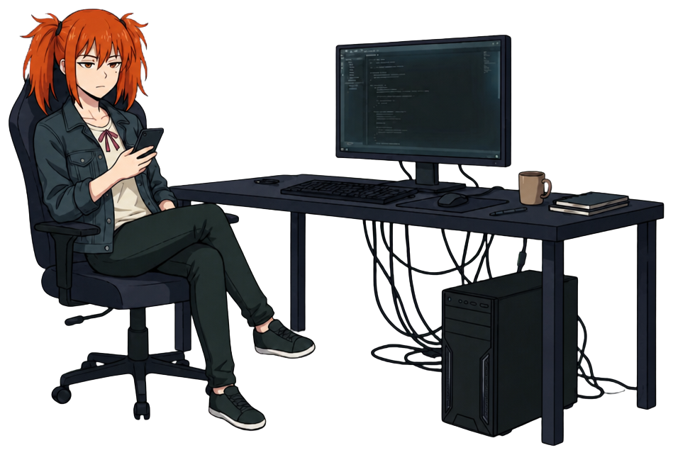

# Gede Krisna

Full-stack engineer in Tabanan, Bali.

I build the software around a property sale: what the buyer uses, what the staff use, and what investors open. Invitations, cameras, and network devices are part of the same work.

At [PT Geonet Properties International](https://geonet.properties) since November 2020.
 
### Coding time

Wakapi started recording from November 13, 2026.

  

### GitHub stats

[Site](https://gproject.dev) · [CV](https://gproject.dev/en/cv) · [Email](mailto:leakmean@gmail.com) · [WhatsApp](https://wa.me/6287862092285) · [LinkedIn](https://www.linkedin.com/in/gede-krisna)
