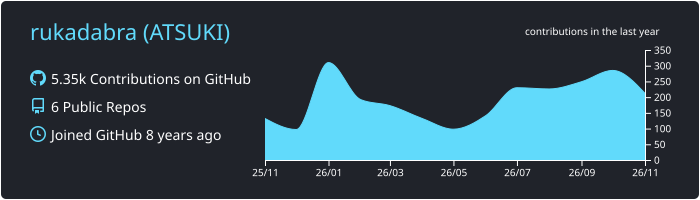
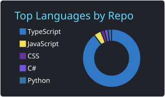
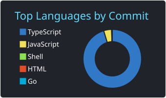
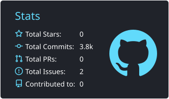
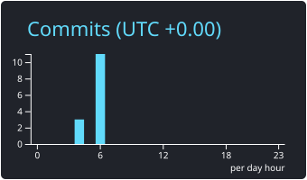

# Gede Krisna

Full-stack engineer in Tabanan, Bali. Buyers see the page. Payment and reports run behind it.

One system for several property brands, including sites that can wear another brand. Also invitations, cameras, and networks.

[gproject.dev](https://gproject.dev) · [CV](https://gproject.dev/en/cv)

## Work

**Multi-brand property commerce.** A buyer picks a property, pays for one unit or several at once, then sees the payment status. The same pattern serves several brands, including Prop Market. Next.js · TypeScript · payments

**Digital invitations.** A guest gets a link, opens the invitation on a phone, and confirms attendance there. Next.js · TypeScript · Tailwind

**CCTV monitoring.** Several cameras are watched from the browser. A dropped picture comes back, and a camera that stays off raises a reminder. NestJS · Docker · TypeScript

**Network device operations.** The network can be read from the browser: the backup internet line, how the load is split, and whether the security state looks wrong. Go · PostgreSQL · Next.js

Since November 2020 I have built the sales system, staff portal, and investor portal at [PT Geonet Properties International](https://geonet.properties).

## Languages and tools

**Languages:** TypeScript, JavaScript, Go, PHP, HTML, CSS

**Technologies:** React, Next.js, Tailwind CSS, NestJS, PostgreSQL, MongoDB, Firebase, Zod, Docker, Turborepo

## GitHub stats

 
 

## Contact

Open to full-stack roles and contracts.

- **Site:** [gproject.dev](https://gproject.dev)
- **Email:** [leakmean@gmail.com](mailto:leakmean@gmail.com)
- **WhatsApp:** [+62 878-6209-2285](https://wa.me/6287862092285)
- **LinkedIn:** [Gede Krisna](https://www.linkedin.com/in/gede-krisna)
